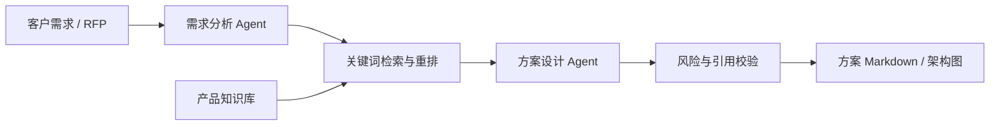

# PreSales Solution Copilot

[](https://github.com/moodn0/agent1/actions/workflows/test.yml)

> 将客户需求文档转成可追溯的售前方案初稿：需求提取、知识检索、能力匹配、POC 设计与架构图。

这是一个面向云与 AI 解决方案售前场景的可运行作品集项目。它不把模型输出当作事实：每项推荐均附带产品知识库中的来源引用，方便售前人员核验与编辑。

## 演示场景

模拟客户「星桥零售」希望为 120 家门店建设客服与运营知识助手。运行示例后会生成一份 Markdown 方案，内容包括：

- 结构化需求、假设和待澄清问题
- 需求—产品能力匹配矩阵（带来源）
- 三阶段 POC 计划、验收指标和风险提示
- Mermaid 架构图，可在 GitHub 中直接渲染

## 快速开始

```powershell
git clone https://github.com/moodn0/agent1.git
cd agent1
python -m venv .venv
.\.venv\Scripts\Activate.ps1
pip install -r requirements.txt
python -m src.cli --input data/sample_rfp.md --output artifacts/proposal.md
```

启动可视化界面：

```powershell
streamlit run app.py
```

或使用 Docker：

```powershell
docker compose up --build
```

## 设计



当前版本以可复现的本地词法检索和规则化工作流为默认实现，便于任何人直接运行与测试。`src/llm.py` 预留了模型适配层；接入受控大模型后，可将需求归纳和方案措辞替换为 LLM，同时保留检索引用与规则校验。

离线版本不需要 API Key。若希望调用任一 OpenAI 兼容模型做**管理层摘要润色**，在 PowerShell 设置环境变量后运行：

```powershell
$env:PRESALES_LLM_API_KEY="你的密钥"
$env:PRESALES_LLM_MODEL="你的模型名"
python -m src.cli --input data/sample_rfp.md --refine-summary
```

模型只能润色已提取的事实；引用、能力匹配和风险边界仍由可审计的本地工作流生成。

## 项目结构

```text
├── app.py                    # Streamlit 演示界面
├── src/
│   ├── workflow.py           # 多阶段售前工作流
│   ├── retrieval.py          # 可解释的本地检索器
│   ├── ingestion.py          # .md/.txt/.docx/.pdf 文档读取
│   ├── llm.py                # 可选、OpenAI 兼容的摘要润色适配器
│   ├── evaluate.py           # 引用覆盖率等可复现指标
│   └── cli.py                # 命令行入口
├── data/
│   ├── knowledge_base/       # 模拟产品文档和案例
│   └── sample_rfp.md         # 可直接运行的客户需求
└── tests/                    # 单元测试
```

## 可验证性

```powershell
python -m unittest discover -s tests -v
python -m src.evaluate
```

`src.evaluate` 会输出本项目示例中“建议项有引用证据”的覆盖率。它是回归检查，不是对真实客户效果的宣称。项目不会虚构“准确率”或客户收益；建议在正式面试前，以你自己的标注 RFP 测试集记录需求召回率、引用覆盖率、人工编辑耗时，以及 POC 验收结果。

## 展示建议

面试录屏或项目介绍可直接采用 [90 秒演示脚本](demo_walkthrough.md)。重点展示“引用证据”和“售前核验清单”：它们体现了生成式 AI 在企业场景中需要可追溯和人工负责，而非单纯生成文本。

## 后续迭代

- 用 Qdrant/pgvector 和 reranker 替代本地检索器
- 接入真实 CRM（仅使用获授权、脱敏的数据）
- 支持 DOCX/PPTX 方案导出与人工审批流
- 加入 RAGAS 或人工盲测评估集

## 许可

MIT
